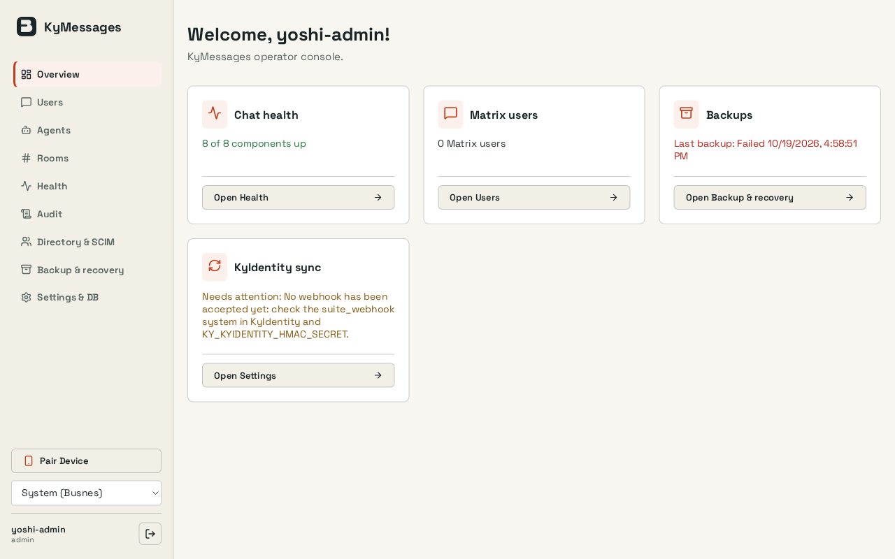
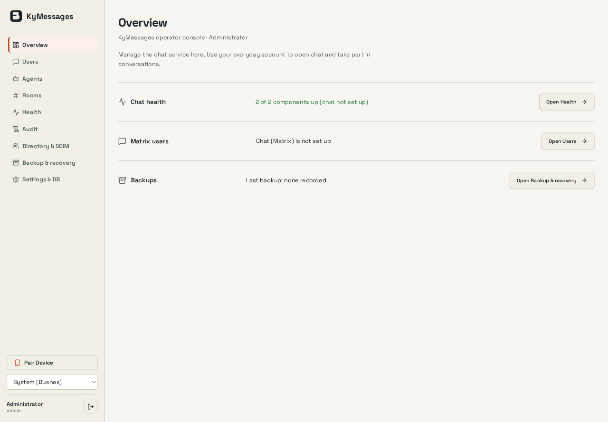
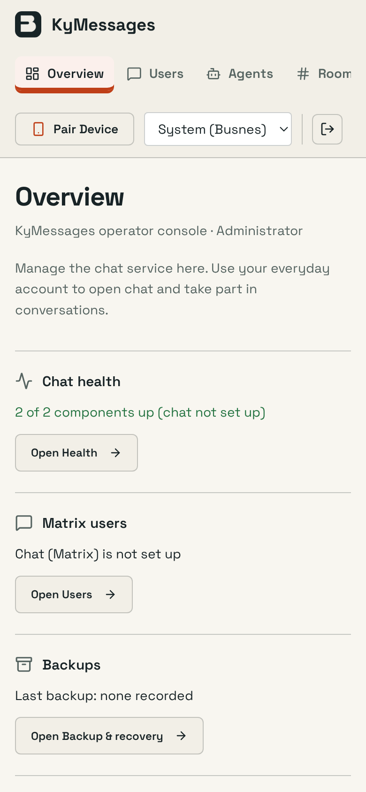
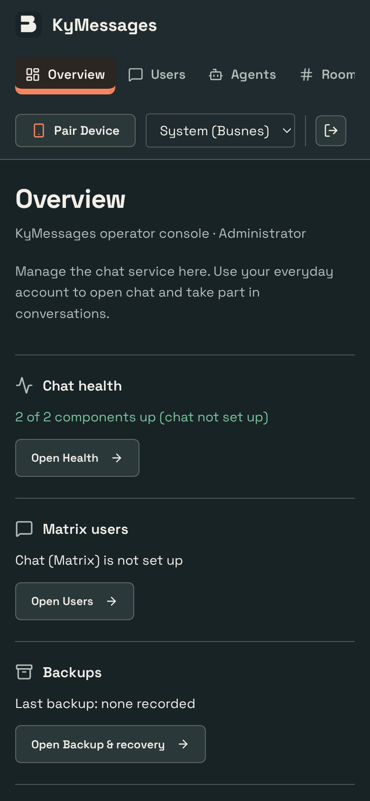

# KyMessage interface polish

KyMessage now has a readable operator summary and a clearer everyday-chat entry. This implements the approved visual direction against the existing product; no mockup data or replacement application shell is shipped.

## Preserved

Independent health/user/backup/sync results, conditional Matrix sync row, all navigation/actions, device pairing, MFA, room/agent/user controls, branding, settings and everyday Open chat/sign-out.

No deployed configuration, accounts, credentials or stored content were changed. Authentication, API clients, persistence, backend logic, dependency manifests and migrations are unchanged. Product themes, palette choices and saved preference keys are retained; hash-pinned shared UI files are untouched. Existing React event-handler expressions were compared against the base revision and retained.

## Evidence

Captured 2026-10-19 from the built interface in T3's native browser, at 1440×1000 and 390×844 CSS pixels. PNG dimensions may be larger because of browser device scaling. The dark capture is a phone view. Capture conditions: Real disposable administrator on a Matrix-disabled instance. The overview explicitly says chat is not set up and no backup is recorded. Real Matrix conversations and crypto acceptance are not claimed from this capture.

Before is the actual installation-campaign screenshot used for the approved proposal. After is this branch on disposable data. Their content differs; these images compare presentation, not a live-data migration.

| Before | Implemented desktop |
| --- | --- |
|  |  |

| Implemented phone | Implemented phone, dark |
| --- | --- |
|  |  |

## Checked

`npm test`: 147 tests passed. Production build passed. Native desktop/phone captures and all frontend tests passed; Chromium light/390 browser regression passed, including CSP, worker, themes, keyboard, pairing dialog, branding, backup and all console navigation with Matrix off. Full Matrix acceptance is outside this UI change.

The inspected phone state had no document-width overflow. This is targeted interface verification, not an exhaustive accessibility or nine-product integration qualification. Repository-wide CI, container/PostgreSQL/real-runtime checks and autonomous review remain separate gates.

## Review

Review [web/src/pages/Dashboard.tsx](web/src/pages/Dashboard.tsx) for the product layout and preserved actions. Generated assets and screenshots can be skipped when reviewing behavior. Check the source layout and existing permission/confirmation boundaries before merging. No deployment or merge is included.
