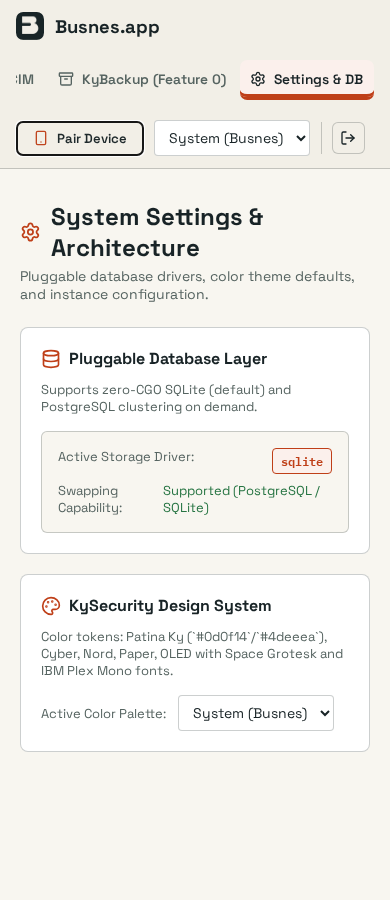
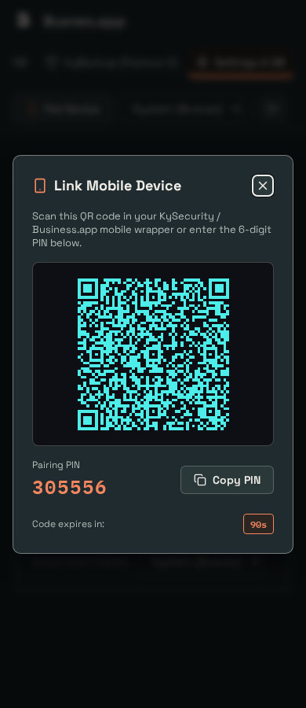

# Shared UI verification

> Evidence scope: this document records the revision, environment and capture conditions below. Screenshots and generated fixtures demonstrate appearance; they do not qualify live email delivery, push delivery, recovery custody or every product feature. Test counts describe that recorded run, not the current suite.

## Change

Include the base as a required consumer so future products inherit verified shared assets. Shared assets are pinned to ky-ui 0.2.0 with content hashes. Product layouts, saved theme keys and named presets remain local.

## Capture conditions

Captured 2026-09-25 from this branch, using the application UI (not a design mockup). Overview in a real scratch server using scaffold defaults.

OS-following Busnes Light and Dark were captured at 1280×900 and 390×844 CSS pixels. Browser device scaling may make PNG dimensions larger. Document width stayed within the viewport in these captured states; local navigation/table scrolling is intentional. Screenshots show the selected-page accent, not a complete accessibility audit.

The subsequent browser-regression change moves worker registration into the JS bundle; production CSP is unchanged. Activation now passes against the real server. HTML refreshes online, and caching excludes dynamic/auth routes.

## Checks

7 frontend tests and production build passed. Central ky-ui sync --check verified all ten consumers. Screenshot coverage is Busnes Light/Dark; existing named choices are retained, but not every named palette/page combination was visually exercised.

## Screenshots

| Light | Dark |
| --- | --- |
|  |  |
|  |  |

## Reproduce

### Automated regression coverage

`web/browser/ui.spec.mjs` runs against a freshly built Go server with disposable SQLite data, real login and production CSP at 390×900 and 1280×900 in both OS themes. CI retains screenshots and failure traces for seven days and requires the browser job before publishing.

The assertions cover worker activation and stale-shell refresh, invalid-login errors, theme persistence and cross-tab/OS transitions, Paper-to-Busnes switching, selected navigation/focus, Settings overflow, and absence of the retired console device-pairing control and its API requests. These are workflow checks, not all-page E2E or full accessibility coverage.

Verified 2026-10-20 after removing console device pairing: `make ci` passed (144 frontend tests), the production frontend built, and all seven browser projects passed in Chromium and Firefox. Desktop light and mobile dark Overview captures were inspected; the suite writes current captures to ignored `web/test-results/`.

Historical captures from the automated run (2026-09-25). The console device-pairing control was removed on 2026-10-20; chat device sign-in and verification belong to Element:

| Mobile Settings — light | Retired pairing dialog — historical only |
| --- | --- |
|  |  |

Build the frontend, then run `go build -o .browser/server ./cmd/server` from the repo root and `cd web && npx playwright install chromium && npm run test:browser`.

Federation panel (2026-10-11): a disposable built server with Matrix configured (no MAS or Synapse) at 1280×800 and 390×844, Busnes dark. Checked the level picker, the inline warnings before widening, adding a server, the restart notice and the status error when MAS is unreachable. The check found and fixed radios stretched by the global `input` width and a restart notice split into columns on mobile.

### Manual inspection

Run npm ci, npm test (where configured), and npm run build in web/, then start the product with isolated local preview data following its README. Use System theme, emulate OS light/dark, and inspect both viewport sizes. Do not point preview instances at production data. For KyVault, use a configured development KyIdentity or explicitly labeled read-only browser fixtures; never bypass backend authentication.

## Approved interface polish — 2026-10-19

See [UI-POLISH.md](UI-POLISH.md) for the implemented changes, preservation scope, checks, actual before/after screenshots and disposable capture conditions. Earlier captures above remain historical evidence.

## Suite cohesion redesign — 2026-10-26

Staged shell, task-view and form changes toward the ky-ui design contract (ky-ui 0.3.0 tokens). Before/after captures for every stage (1280×900 and 390×844, Busnes Light and Dark, disposable loopback server with real sign-in, Matrix not configured), per-stage source patches, image hashes and computed focus/contrast/control/overflow measurements are in the ky-ui council directory `reviews/2026-10-26-council/` (`kymessages-implementation.md`). MemberHome and Element chat were not captured there; see that file for the gap.

Stage 05 usability refinement (2026-10-26), with captures `kymessages-05-{before,after}-*` and notes in that council directory:

- Audit stacks each record as labelled lines on phones, and the desktop columns fit without sideways scrolling.
- Busnes Light marks the selected navigation row with the panel surface, and keeps it under the pointer.
- Network-check lines carry a status icon and colour.
- Backup shows an empty local directory and an idle schedule without a success badge.
- Overview rows share one grid.
- Transport failures say the server could not be reached.

Loading and offline states were captured from real CDP latency and an offline browser context, with no mocked responses.

Checks:

- Passed: `make ci` (155 frontend tests, smoke 85 checks), `test:browser` 7/7, and a Chromium and Firefox keyboard and semantics check of the phone Audit table.
- Not run: WebKit, because host libraries are missing.

Stage 06 correction and final capture (2026-10-26), `kymessages-06-*` in the same council directory:

- **Health:** a failed recheck no longer leaves an earlier report's green Up badges, or the network marks, on screen.
- **Overview:** an unreachable server no longer adds a KyIdentity sync row.
- **Final set:** `kymessages-06-after-*` holds 78 images from one source and binary. It covers every console and auth surface Matrix-off can reach, plus loading and offline states, in Busnes Light and Dark at 1280×900 and 390×844.

Checks:

- Passed: `make ci` (157 frontend tests; smoke on port 18097, 85 checks) and `test:browser` 7/7.

Stage 08: navigation hover fix (2026-10-26, finding F1 of the council runtime-source review).

- **Defect.** Hovering an unselected navigation row filled it with the primary-button accent. Text contrast was 2.53:1 in Busnes Light and 1.94:1 in Busnes Dark.
- **Fix.** The global button hover now excludes `.ky-nav-item`. The hovered row is now `rgb(227,225,217)` (12.27:1) in Light and `rgb(43,56,58)` (10.57:1) in Dark. The selected row is unchanged under the pointer.
- **Evidence.** Captures `kymessages-08-{before,after}-*` come from the real signed-in app on a disposable server. The vendored ky-ui files are unchanged.
- **Regression test.** `ui.spec.mjs` fails on the pre-fix CSS in all 6 Chromium and Firefox projects and passes with the fix.
- **Checks.** `test:browser` 7/7. `make ci` passes (157 tests; smoke on port 18097).

## Fleet Appearance picker — 2026-10-26

KyMessages gained an Appearance page for every role (members get Home and Appearance rows; Match system plus the 22-theme suite catalog as native radio cards, saved `ky_theme` IDs kept); the header and Settings theme selects are gone. Staged before/after captures at 1280×900 and 390×844 in OS light and dark, with source patches, binary and asset hashes and per-file measurements, are in [docs/ui-fleet-2026-10-26/](docs/ui-fleet-2026-10-26/README.md) (`manifest.json`, `captures.csv`, `checks.csv`). They are scratch captures with synthetic data and carry no rating.
