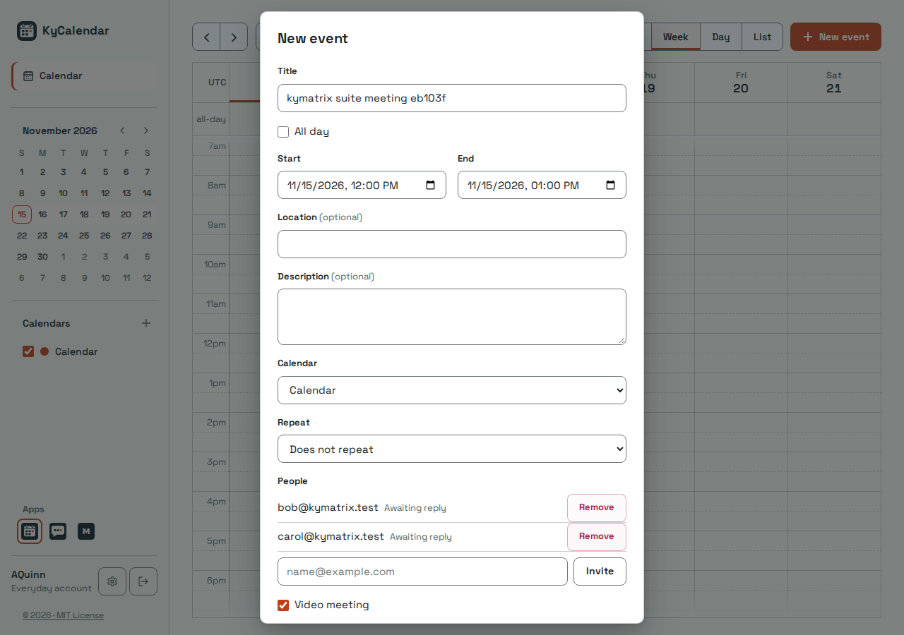
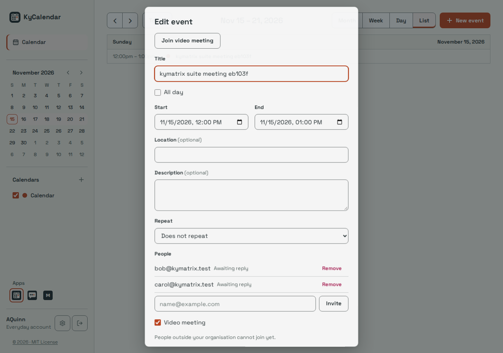
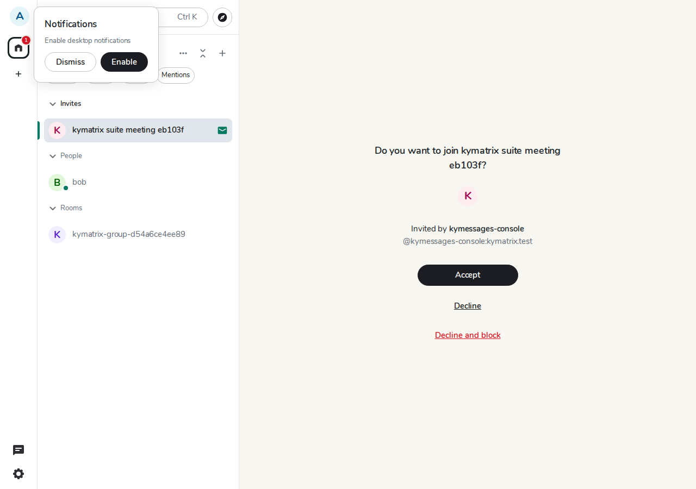
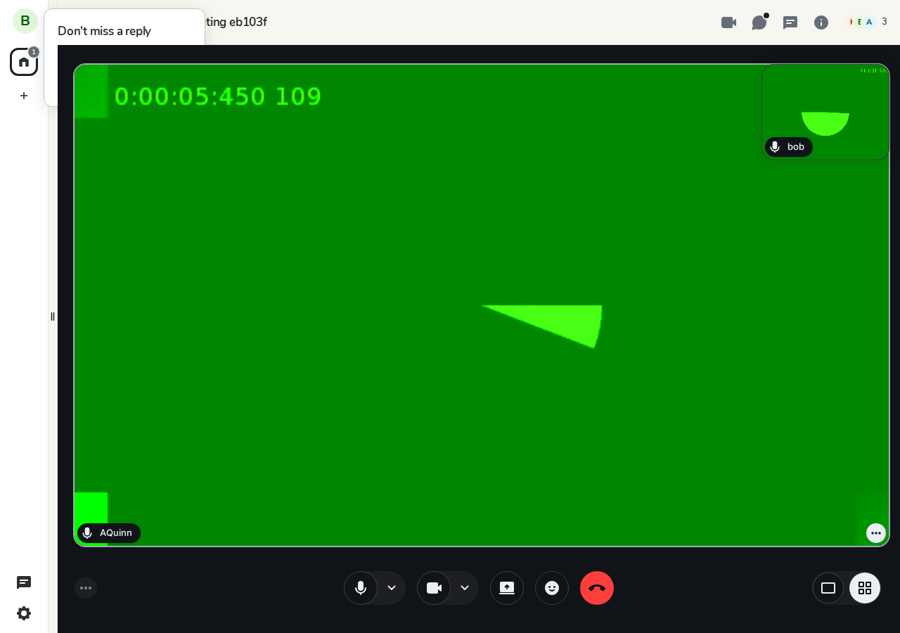

# Evidence: KyCalendar meetings on a real KyMessages stack, 2026-11-15

Workflow `suite-meetings.yml`, PR #131, head `6b6c28d`, run 43662862305 on GitHub Actions. It
passed twice at that head, attempt 1 and attempt 2, step `suite-meetings` in 61 s and 67 s.
KyCalendar `main` (with the issuer fix, KyCalendar #142) and KyIdentity `master` were built
from source. Contract: [../KYCALENDAR.md](../KYCALENDAR.md).

## Proven

1. **Pairing through KyIdentity only.** The console reports `connected`, source `kyidentity`,
   KyCalendar's URL. KyCalendar logs `[KYMESSAGES] linked through KyIdentity`. Neither app
   has a pairing variable. A PUT signed under any other secret gets 401 `bad_signature`.
2. **Video meeting on, two organisation attendees.**
   - The switch is shown, off without guests and on once bob and carol are added, with the
     outside-the-organisation line beside it.
   - The console creates the room: encrypted, invite only, history from joining, named after
     the event.
   - The stored event carries `CONFERENCE;VALUE=URI;FEATURE=VIDEO;LABEL=KyMessages:<url>` and
     ends with `Join: <url>`.
3. **Invites and Join.** alice and bob are invited. Join on KyCalendar's event opens that room
   in alice's Element. Both accept, read each other's encrypted messages, and hold a video
   call that bob joins (both decode video).
4. **Changes.**
   - carol had no chat account: skipped.
   - After she signed in to Element, the next change (a rename) invited her and renamed the
     room.
   - Removing her from the event removed her, with the console as the sender.
5. **Closing.** Switching the meeting off blocked the room and alice was out. Deleting a
   second event closed its room.

## Defects found

- **KyCalendar sent its account binding as `issuer`** (`kyidentity https://…`), so a real
  KyMessages answered every PUT with 404 `no_user`. Fixed in KyCalendar #142.
- **The meeting ID in the path was not signed.** Both sides now carry `"id"` in the signed
  body: KyMessages #132 refuses a mismatch, and KyCalendar #143 sends the field.

## Known gap (not fixed)

KyCalendar sends a PUT only when the body it would send changes. A skipped person who gets a
chat account later is invited at the next change of title or attendees, not at a change of
time or description. The wire contract is met (a later PUT picks them up). Closing the gap is
a KyCalendar change: for example, keep a meeting due while `skipped_subs` is non-empty.
