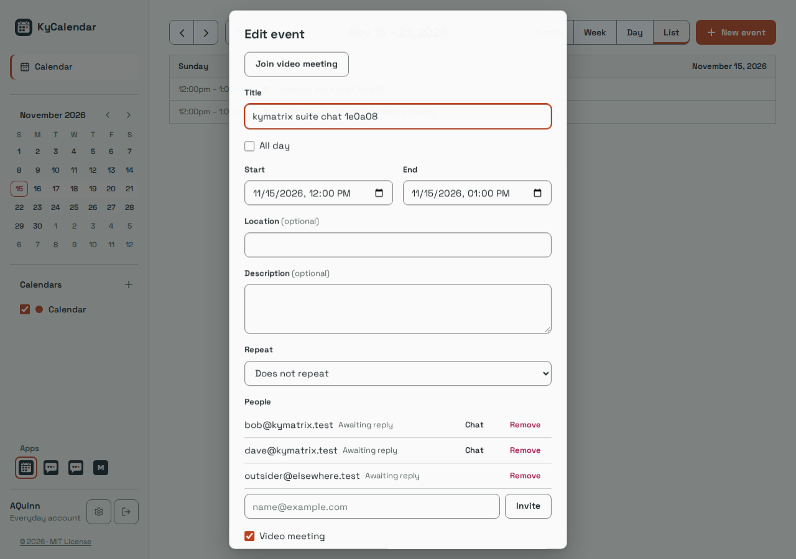
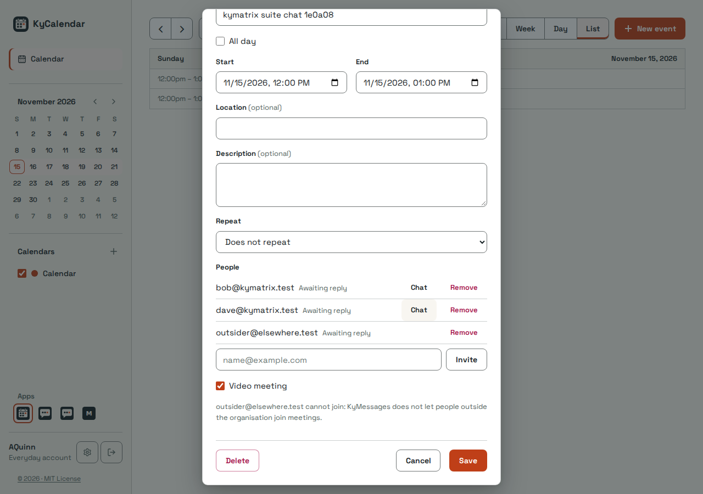
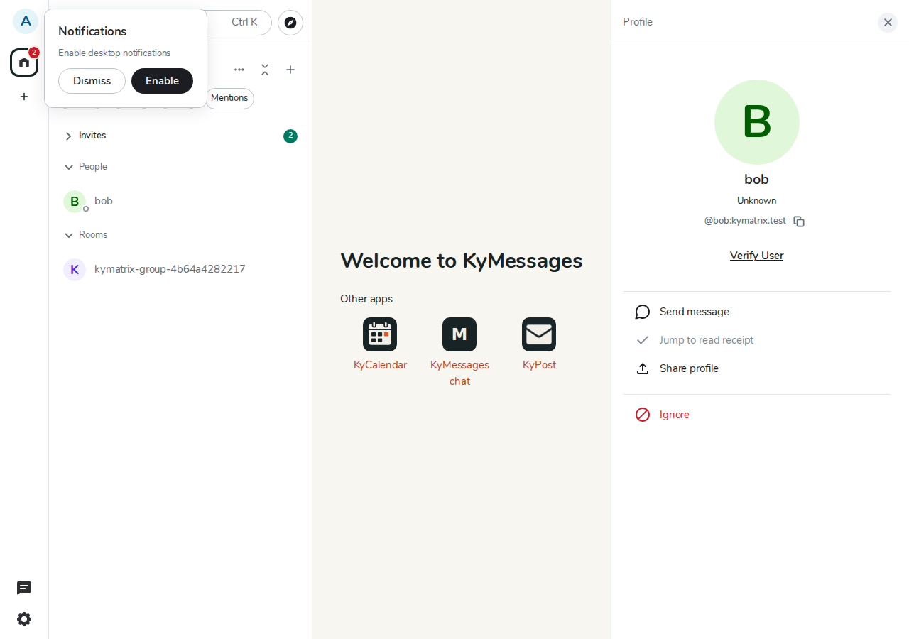
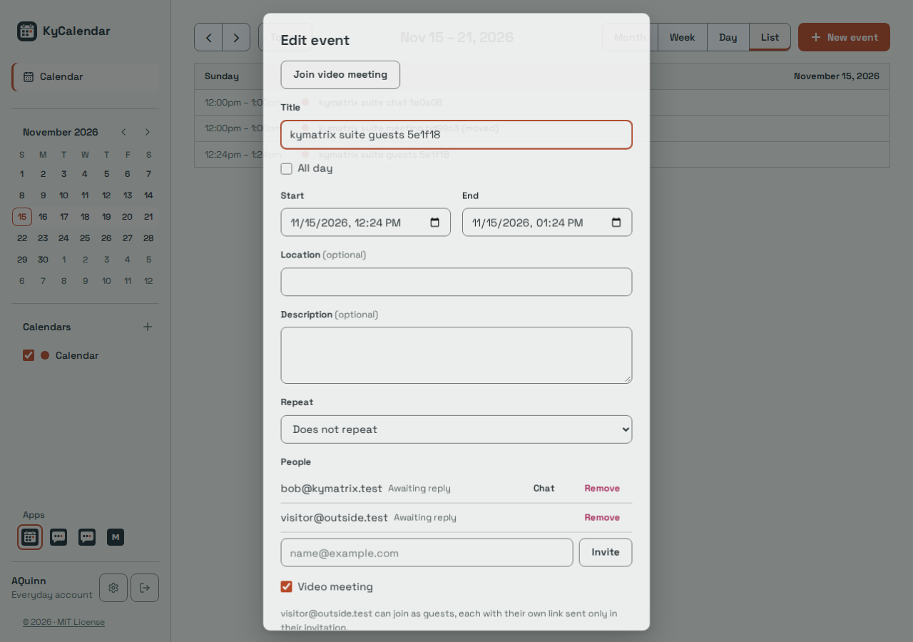
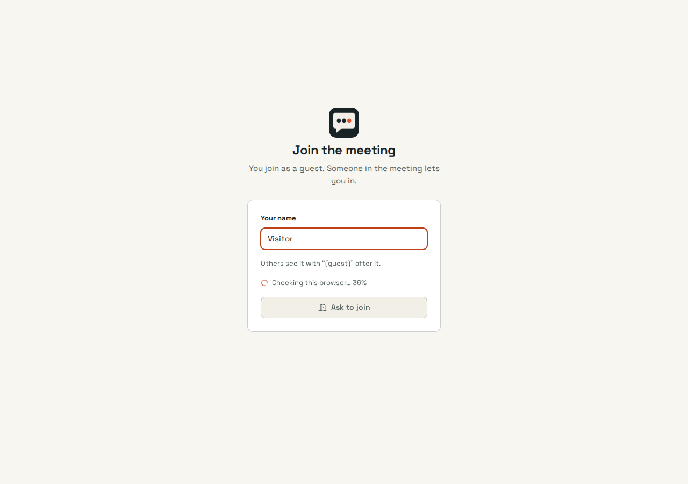
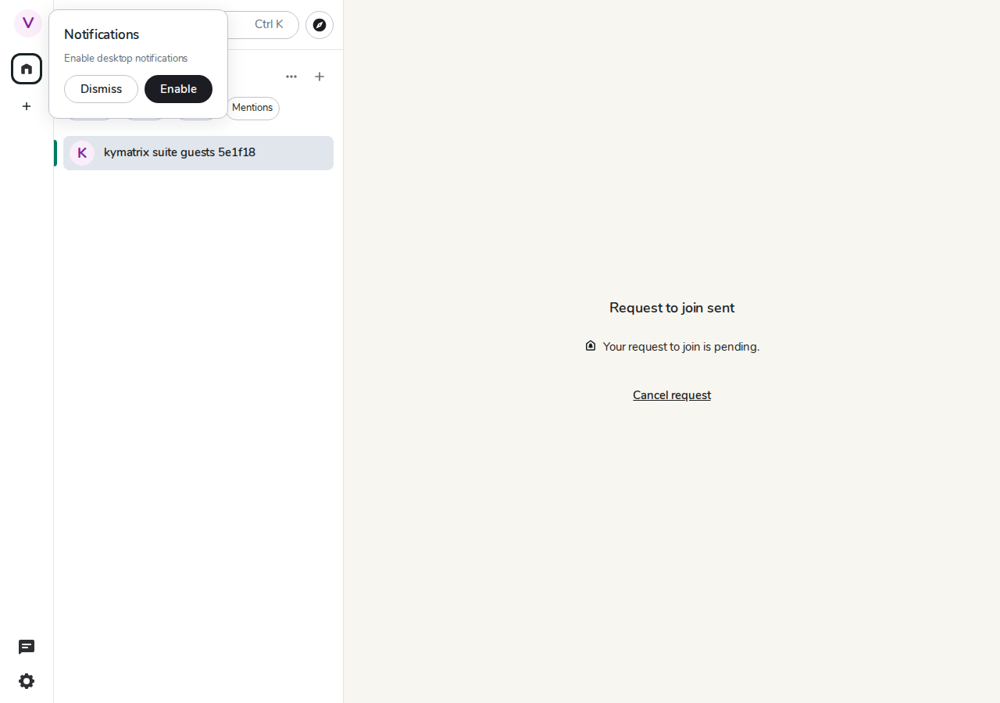
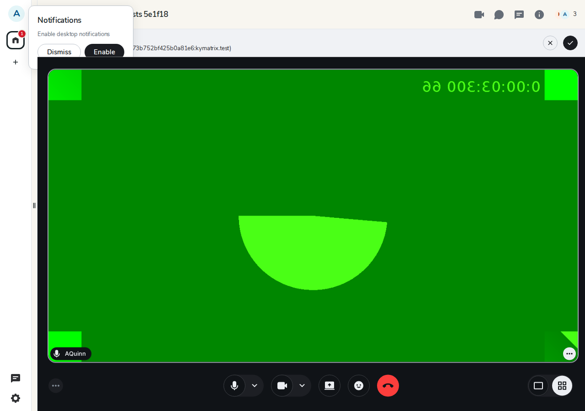
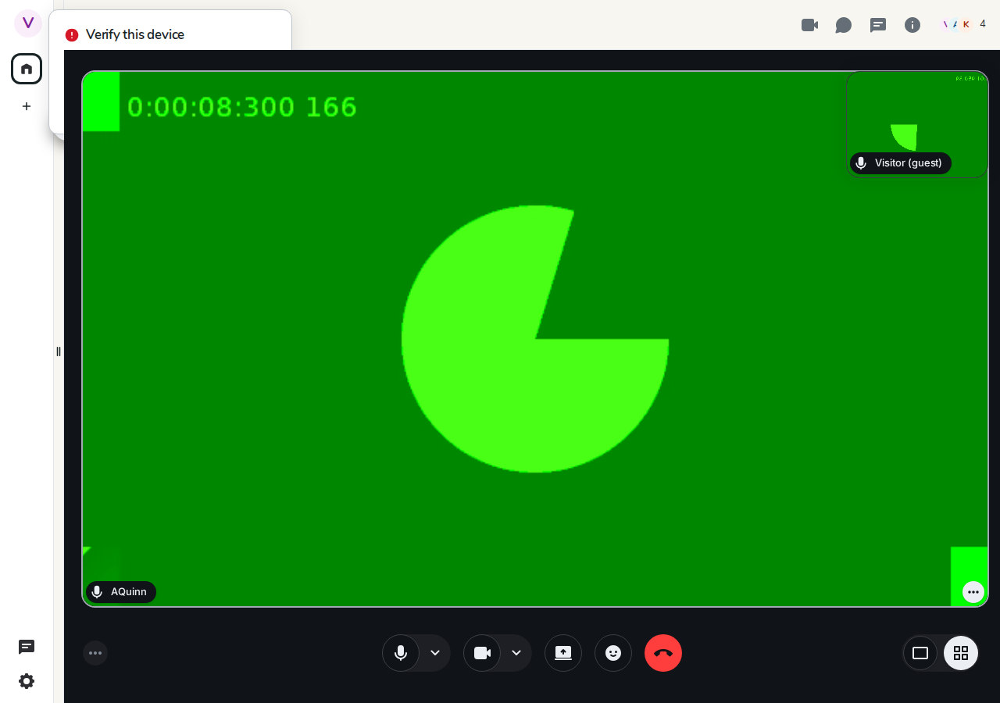

# Suite wave 2 across real servers: KyCalendar chat and meeting guests

Workflow `.github/workflows/suite-meetings.yml`, run
[43712701880](https://github.com/Busnes-app/KyMessage-Server/actions/runs/43712701880)
(PR #140, head `87a65b5`, 2026-11-15), on GitHub's `ubuntu-latest`. KyIdentity (`master`) and
KyCalendar (`main`, with #144 contract H and #146 contract L) are built from source;
KyMessages from this branch. Summary: `build`, `matrix-init`, `stack`, `kyidentity`, `prove`,
`suite-meetings`, `suite-chat` and `suite-guests` all PASS (539 s).

## Set-up

- KyCalendar and the console pair only through KyIdentity's `/api/suite/peer`.
- KyPost is a **stand-in** on the harness proxy (`post.kymatrix.test`, KyIdentity client
  `kypost`). KyCalendar pairs with it through KyIdentity as it would with a real KyPost. It
  records each `kycalendar.itip.send`, answers 200 and mails nothing.
  `scripts/matrix-acceptance/kypost-sink.py` checks every recorded message's syncauth v1
  signature against the KyCalendar–KyPost secret that KyIdentity issues.
- Element is registered as the KyIdentity client `kymessage-chat` with its launch URL. This
  is the suite app that KyCalendar's Chat action requires.

## Contract H: Chat from KyCalendar

- Proven: the Chat action on an organisation attendee (bob) opens a new tab on
  `https://chat.kymatrix.test/#/user/@bob:kymatrix.test`, and Element shows bob's profile with
  "Send message".
- Proven: dave is in the organisation but has no chat account; his Chat says "This person
  isn't on KyMessages yet."
- Proven: an outside attendee and alice herself get no Chat action.
- Proven: requests signed with the KyIdentity-issued secrets are refused for self
  (`no_target`), a KyIdentity administrator identity as the target (`no_target`) or the caller
  (`no_user`), a missing field (`bad_body`), KyPost's event type under KyCalendar's secret and
  an unknown key (`bad_signature`). A replay answers `duplicate`.
- Proven: `kypost.chat.open` works under the KyPost pair.
- Proven: the `chat.open` audit rows hold no subject, link or secret.
- **Unproven: KyPost's own Chat action on a sender.** KyPost (a full mail stack with IMAP) is not
  in this stack. Only the console side of `kypost.chat.open` is exercised, with the harness
  signing as KyPost. KyPost covers its UI in its own tests (KyPost #613).
- Limit: KyIdentity's administrator has no KyMessages account here, so its refusal goes through
  the "no account" path. The console's role check for an administrator who does have one is
  covered by `internal/api/suite_chat_test.go` only.

## Contract L: meeting guests from KyCalendar

Switch on:

- An event that alice creates now with bob and `visitor@outside.test` gets a member room and a
  guest key for the visitor. The event API shows `guests: ["visitor@outside.test"]` with no
  error, and the editor reads "visitor@outside.test can join as guests, each with their own link
  sent only in their invitation."
- KyCalendar handed KyPost the visitor's REQUEST carrying
  `Join as a guest: https://admin.kymatrix.test/meet#<43 chars>`. Every copy to the visitor
  holds that same link, and no other recorded message holds it: bob's copies have none.
- The stored event keeps its CONFERENCE property and `Join:` line. The link's token is
  nowhere in KyCalendar's database files in the clear.
- The visitor's browser opens the link (the console's `/meet` page), enters a name, and solves
  the proof-of-work captcha automatically. Then:
  - the bootstrap page signs them in and the one-time code leaves the address bar;
  - they knock, and alice sees the knock with "(guest)" from inside her call and admits them;
  - both decode each other's audio and video.

Switch off:

- Turning guests off ends the live guest account at once.
- A new event with bob and `visitor2@outside.test` still gets its room, and bob is invited.
- The event records `guests_error: guests_off`. The editor reads "visitor2@outside.test
  cannot join: KyMessages does not let people outside the organisation join meetings."
- The visitor's invitation goes out without a link, after KyCalendar's wait for KyMessages'
  answer: 57 s in this run.

## Existing meeting steps

`suite-meetings` passed unchanged in the same run: room creation, Join, the call, carol's
late invite and removal, switch off and delete.

## Screens

| | |
|---|---|
|  |  |
|  |  |
|  |  |
|  |  |
|  | |

The screenshots are 1280 px wide, light theme, from the harness. This PR changes no app
screen, so it has no before/after pairs.

## Step log

```
== suite-chat
  ok: the Video meeting switch is shown, off for an event without guests
  ok: the switch turns on by default once the event has guests
  ok: the editor says how people outside the organisation would join
  ok: no Chat action for outsider@elsewhere.test
  ok: no Chat action for alice herself
  ok: Chat with dave@kymatrix.test, who has no chat account, says so
  ok: Chat with bob@kymatrix.test opened Element's user view of @bob:kymatrix.test
  ok: KyCalendar's Chat on bob returned Element's user view of bob
  ok: signed as KyCalendar, alice to bob is Element's view of bob
  ok: alice to herself is refused
  ok: a target that is KyIdentity's administrator identity is refused
  ok: the administrator identity as the caller is refused
  ok: a target with no chat account is refused
  ok: a body without target_sub is refused
  ok: KyPost's event type under KyCalendar's secret is refused
  ok: a request under another key is refused
  ok: an exact replay answers duplicate
  ok: signed as KyPost (paired through KyIdentity), bob to alice is Element's view of alice
  ok: chat.open audited for every verified request, with IDs only: no subject, link or secret
PASS suite-chat             9s
== suite-guests
  ok: the administrator turned meeting guests on
  ok: the Video meeting switch is shown, off for an event without guests
  ok: the switch turns on by default once the event has guests
  ok: the editor says how people outside the organisation would join
  ok: KyCalendar made the outside attendee a guest; KyMessages took it
  ok: the editor says the visitor joins with their own link
  ok: KyCalendar handed KyPost the visitor's invitation with a guest link (3s)
  ok: every invitation to the visitor carries that one link
  ok: bob's invitation went out, without a guest link (0s)
  ok: the link is in the visitor's own copies only; every message was signed under KyIdentity's KyCalendar-KyPost secret
  ok: the stored event keeps the member room and Join line; the guest link is nowhere in KyCalendar's database in the clear
  ok: the bootstrap page signed the guest in as @guest-4f73b752bf425b0a81e6:kymatrix.test
  ok: the one-time code is gone from the address bar
  ok: members see the knock with the (guest) suffix
  ok: alice and the guest receive audio and decode each other's video
  ok: the visitor joined from their invitation's link; members see the guest suffix
  ok: alice admitted the visitor
  ok: turning guests off ended every live guest account (0s)
  ok: the Video meeting switch is shown, off for an event without guests
  ok: the switch turns on by default once the event has guests
  ok: the editor says how people outside the organisation would join
  ok: with guests off KyCalendar still made the member room and invited bob
  ok: KyMessages refused the guest (guests_off) and KyCalendar kept the room without it
  ok: the editor names the attendee who cannot join and why
  ok: the visitor's invitation went out without a guest link (57s)
PASS suite-guests         101s
== stopping after suite-guests
```
